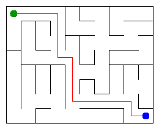

# Assignment 3. Maze Escape

Student ID: 25257  
Name: Ismail Bolat  
Group: SE-2512  
Maze size (rows x columns): 8 x 10

## Program output

The 13 lines printed by `java -cp out Main` on my data:

```text
Broken: 79
Kept: 63
Last broken wall: 124
MST cost: 24104
Heaviest broken wall: 905
Path length: 16
DFS visited: 51
Dead ends: 23
Zones: 8
Largest zone: 17
Is DAG: 0
Flow stages: 6
Fastest route cost: 19
```

My maze:



## Questions

**Mission 0. What do find and union do, and what makes them fast in your code?**  
`find` returns the representative of the group that contains a cell. `union` joins two different groups and returns false if they are already together. Union by size keeps trees shallow, and path compression shortens paths during `find`.

**Mission 1. Why is Broken always R*C - 1, and Kept always (R-1)*(C-1)?**  
There are `R*C` cells, and each successful union connects two previously separate groups, so exactly `R*C - 1` walls are broken to connect all cells. The total number of inner walls is `R*(C-1) + C*(R-1)`, so the number kept is the total minus `R*C - 1`, which equals `(R-1)*(C-1)`.

**Mission 2. My MST cost from Kruskal and from Prim, and why they are equal:**  
Kruskal's MST cost is `24104`, and Prim also gives `24104`. Both algorithms find a minimum spanning tree of the same connected weighted graph, so their total minimum cost must be equal.

**Mission 3. Why is there exactly one path between two cells? How did you avoid a stack overflow on a huge maze?**  
Mission 1 connects every cell and breaks only walls that join separate components, so the result is a tree. A tree has exactly one path between any two cells. I used an iterative DFS with arrays as a stack instead of recursive calls, so a very long path does not overflow the Java call stack.

**Mission 4. Why does the second pass of Kosaraju go on the reversed graph? Why do the slides have no cycle exactly when Zones equals the number of cells?**  
The first DFS finish order helps choose a component that can be safely collected in the reversed graph without mixing different strongly connected components. If there is a directed cycle, at least two cells belong to the same strongly connected component; therefore, there are fewer zones than cells. If every cell is its own zone, there is no directed cycle.

**Mission 5. Why is it enough to go through the zones in the order of their numbers? What does this pass cost?**  
The component graph is a DAG, and Kosaraju numbers its zones in topological order, so all incoming zones are processed before a zone. That lets the program update the longest chain and cheapest route in one pass without a priority queue. Grouping and processing the slides takes `O(k + m)` time, where `k` is the number of zones and `m` is the number of slides.

## AI use

I used ChatGPT to help understand the assignment, implement and review the algorithms, check test failures, and improve the explanations in this report. I reviewed the result and should make sure I can explain the code during the defense.

## Timing (Mission 7)

Milliseconds, five runs, from `java -cp out Bench` in the environment where this report was prepared. Results can differ on another computer.

| maze | Kruskal average (ms) | Prim average (ms) |
|---|---:|---:|
| 100 x 100 | 9 | 7 |
| 300 x 300 | 89 | 49 |
| 1000 x 1000 | 1002 | 1605 |

The time grows as the maze gets larger because the number of cells and walls grows quickly. The relative speed depends on the graph size and the computer; in these runs Prim was faster on the 100 x 100 and 300 x 300 mazes, while Kruskal was faster on the 1000 x 1000 maze.

## Complexity

Here `n` is the number of cells, `m` is the number of walls or slides, and `k` is the number of zones.

| algorithm | time | space | assumptions |
|---|---|---|---|
| DSU find and union | amortized `O(α(n))` per operation | `O(n)` | union by size and path compression |
| Kruskal | `O(m log m)` | `O(n + m)` | sorting walls, then DSU operations |
| Prim | `O((n + m) log n)` | `O(n + m)` | adjacency arrays and priority queue |
| DFS | `O(n + m)` | `O(n + m)` | iterative DFS; maze graph is built first |
| Kosaraju | `O(n + m)` | `O(n + m)` | two iterative DFS passes on the graph and reversed graph |
| Route in the zone graph | `O(k + m)` | `O(k + m)` | zones are already in topological order |

## Before submitting

- `data/walls.txt`, `data/slides.txt`, and `output/maze.png` are included.
- `java tools/Check.java` passes all three examples and the DSU checks.
- `output/maze.html` is included so the maze can be explored in a browser.
- Push the project to a public GitHub repository and submit its URL in Moodle.
